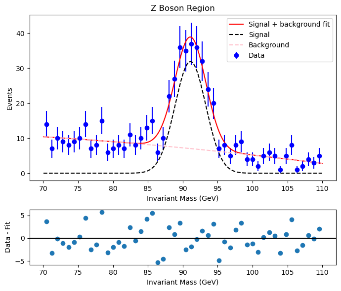

# Z Boson Mass Reconstruction using CERN Open Data
Python analysis of dimuon events from CERN Open Data to reconstruct the Z boson mass.

## Result

- Z mass: **91.10 ± 0.13 GeV** (consistent with the accepted value of 91.19 GeV)
- Width: 2.21 ± 0.15 GeV
- Goodness of fit: χ²/ν = 0.96
- Significance of the signal: 12.4σ

## Method
1. Extract and clean data from the CERN Open Data sample.
2. Calculate the invariant mass of each muon pair: this is the mass of the particle that decayed into them, according to special relativity.
3. Fit the mass peak with a signal-plus-background fit consisting of a Gaussian signal and a quadratic background.
4. Evaluate the goodness-of-fit and statistical significance.

## Files

- `dimuon_analysis.py`: the analysis functions. It reconstructs the invariant
  mass of each muon pair from its four-momenta, fits a Gaussian signal plus a
  quadratic background to the 70-110 GeV region, and calculates the
  goodness of fit (χ²/ν), the signal significance and the plots.
- `run_analysis.py`: the script to run. It asks which plot to show (raw
  spectrum, Z boson region, or both) and prints the fitted mass, width,
  significance and χ².
- `z_fit.png`: the final fit plot, with the data, fitted model and residuals.
- `Reconstruction_of_the_Z_Boson_mass_using_CERN_Open_Data.pdf`: the full
  written paper.
- `dimuon_data.txt`: the muon energies and momenta from the CERN Open Data
  Portal that the program reads.

## How to run

Requires Python with [NumPy, SciPy, Matplotlib].

## Data

Data obtained from the Run2010B public Mu dataset, found at:
https://opendata.cern.ch/record/700/files/MuRun2010B_0.csv
